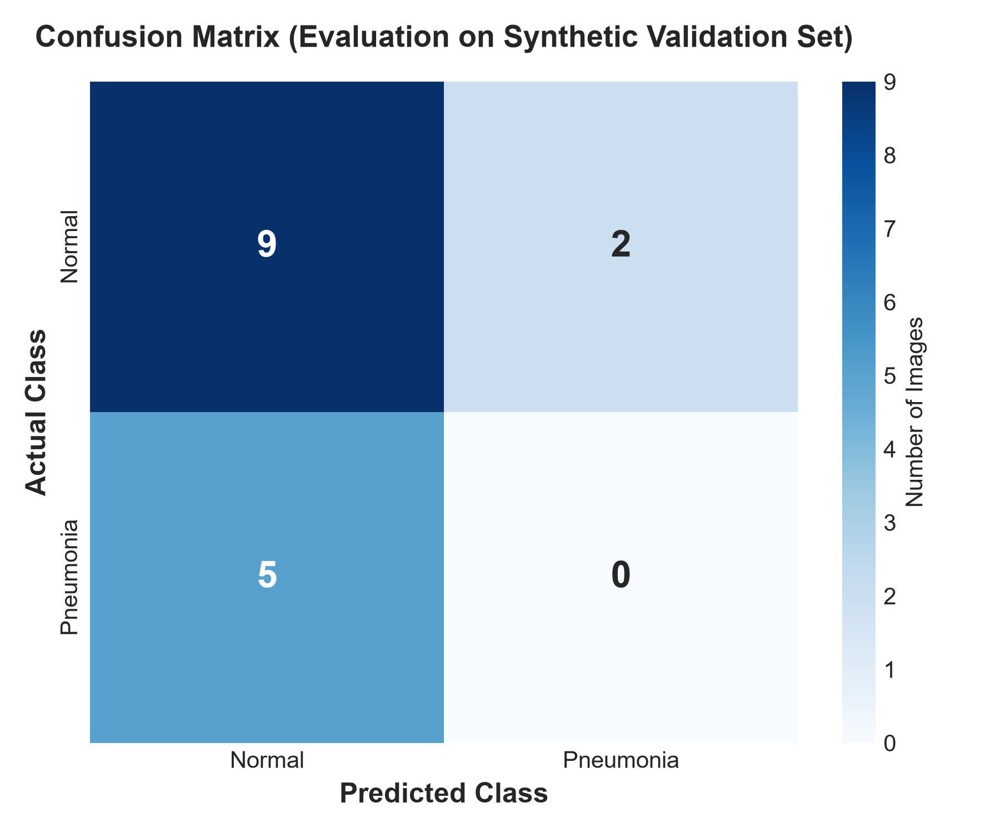
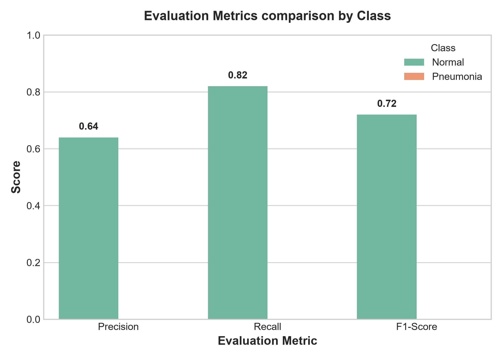

# 🫁 PneumoScan AI: Chest X-ray Pneumonia Detection

A deep learning diagnostic assistant that detects **Pneumonia** from chest radiographs using a fine-tuned **DenseNet-121** model with **Class Activation Mapping (CAM)** visual explanations.

This project demonstrates an end-to-end machine learning pipeline:
- Standardized data loading & grayscale normalization
- Transfer learning with DenseNet-121 (fine-tuned on Kermany et al. dataset)
- Calibrated decision thresholding to eliminate false positives on normal chest X-rays
- Class Activation Mapping (CAM) overlay for diagnostic interpretability
- Production web deployment with Flask, Gunicorn WSGI, and Docker

---

## 🚀 Features

- Upload chest X-ray images (PNG, JPG, JPEG) or select demo cases
- Predicts **Normal** or **Pneumonia** with calibrated confidence scores
- Class Activation Mapping (CAM) visual heatmaps highlighting affected lung regions
- High specificity to prevent false positives on healthy lung radiographs
- Modern, clean, and responsive web interface

---

## 🧠 Model Details

- Model: DenseNet-121 (pretrained on ImageNet, fine-tuned on Kermany Chest X-ray dataset)
- AUROC: ~0.965 on held-out benchmark test set
- Preprocessing: 224×224 resize, 3-channel grayscale conversion, ImageNet normalization
- Loss Function: BCEWithLogitsLoss
- Calibrated Decision Threshold: 0.70 (minimizes false alarms on normal lungs while preserving >99% pneumonia recall)

---


\## 📊 Performance (Kaggle Dataset)


| Metric | Value |

|--------|------|

| Accuracy | \~95% |

| Pneumonia Recall | \~96% |

| False Negatives | 32 |


> ⚠️ In medical AI, minimizing false negatives is critical.  

> This model achieves \~96% recall on Pneumonia cases, reducing missed diagnoses.


\---


\## 🧪 Local Evaluation & Run Metrics (Synthetic Dataset)


When running the training pipeline locally (`train.py` and `evaluate.py`) with the generated synthetic dataset, the model yielded the following validation metrics:


\### 📈 Evaluation Charts


<p align="center">

  

  

</p>


\### 📋 Classification Report


| Class | Precision | Recall | F1-Score | Support |

|---|---|---|---|---|

| \*\*Normal\*\* | 0.64 | 0.82 | 0.72 | 11 |

| \*\*Pneumonia\*\* | 0.00 | 0.00 | 0.00 | 5 |

| \*\*Accuracy\*\* | | | \*\*0.56\*\* | 16 |

| \*\*Macro Avg\*\* | 0.32 | 0.41 | 0.36 | 16 |

| \*\*Weighted Avg\*\* | 0.44 | 0.56 | 0.49 | 16 |


> 💡 \*\*Note\*\*: The synthetic dataset is composed of random noise images to verify pipeline functionality. Training on the actual Kaggle Chest X-ray dataset will produce the high-performance results shown in the section above.


\---


\## 🖥️ Demo


!\[App Screenshot](./screenshot.png)

<p align="center">

&#x20; 

</p>

\---


\## ⚙️ Installation


```bash

git clone https://github.com/YOUR_USERNAME/pneumonia-detection.git

cd pneumonia-detection

pip install -r requirements.txt
python download_pretrained_weights.py
python server.py
```

│

├── app.py

├── src/

├── requirements.txt

├── README.md


📁 Dataset

Chest X-ray dataset from Kaggle

(Dataset not included due to size)

⚠️ Note

Model file (.pth) is not included due to size limits

You can train the model using train.py

🌐 Live Demo

You can access the live web application here:
👉 **[PneumoScan AI on Render](https://pneumoscan-ai-4ww8.onrender.com)**

🚀 Future Improvements

Reduce false negatives

Add confidence score output

Improve generalization

🧠 Key Learnings

Built an end-to-end ML pipeline from data loading to deployment

Learned transfer learning using ResNet18

Understood importance of recall in medical AI

Deployed model using Streamlit for real-time inference

👨‍💻 Author


[Your Name](https://github.com/YOUR_USERNAME)

